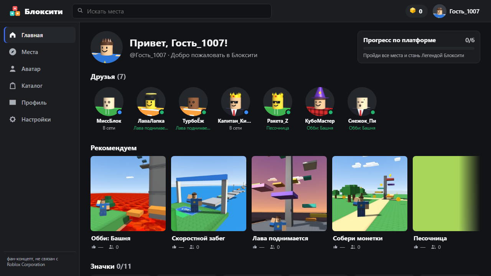
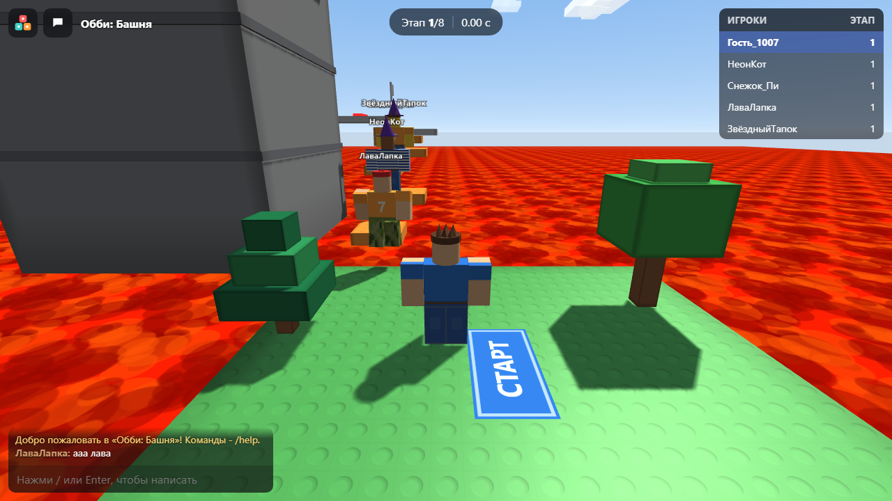
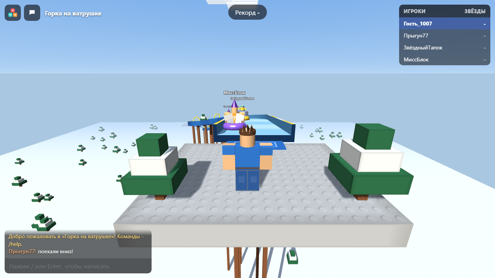

<div align="center">

# BlockCity - Blockcity

**Blockcity («Блоксити») is a platform of small 3D places in the browser: an obby tower, a speed run, the floor is lava, a coin rush, a sandbox and a tube slide, with an avatar, friends-bots, badges and a catalogue. It runs in the browser with no server and no internet: open `index.html` or play it online.**

[**▶ Play online →**](https://alexalesha.github.io/BlockCity/) &nbsp;·&nbsp; [Русская версия этого файла](README.ru.md)

[](#) [](LICENSE) [](https://developer.mozilla.org/docs/Web/HTML) [](https://alexalesha.github.io/BlockCity/) [](https://claude.com/claude-code)

Code, tests and docs are written by Claude (Anthropic) in Claude Code. Ideas, testing and decisions - Alexey.

</div>

> Fan concept, not affiliated with Roblox Corporation. All places, characters and names are original and made by code.

The interface is in Russian or English (Settings).







## What is in the game

- **Six places:** Tower Obby, Speed Run, The Floor Is Lava, Coin Rush, Sandbox (building) and Tube Slide; bots play along.
- An avatar editor and a catalogue, a profile with badges, friends, chat in places, a player list (Tab).
- Russian and English interface; settings; progress is saved in the browser.
- three.js r149 in `vendor/` (MIT).

## Controls

| Key | Action |
|---|---|
| W A S D or arrows | move |
| Space | jump |
| Mouse | camera |
| Enter or / | chat |
| Tab | player list |
| R | reset the character |
| Esc | menu |

Keys can be changed in the settings where the game offers it; a gamepad works too where noted above.

## Run locally

Open `index.html` in Chrome, Edge or Firefox. Everything is in the repository; nothing is downloaded.

## Tests

The laws are Playwright tests in `tests/`. They open the page by its file address in headless
Chromium, one at a time:

```
npm install
npx playwright install chromium
npm test
```

Mouse capture in the tests is always a stub (a real `requestPointerLock` in headless Chromium on
Windows can clip the user's cursor).
`npm run screenshots` makes the pictures above.

## History

The game was made in the [Hub](https://github.com/ALEXalesha/ALEXalesha.github.io) collection, where it also runs in the Hub ([play there](https://alexalesha.github.io/)). This repository carries the game with its commit history.

## Licence

MIT, see [LICENSE](LICENSE). three.js: MIT.
